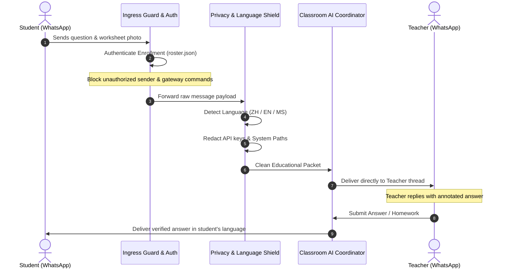

# 🎓 Next Genn Edu - Tuition Classroom WhatsApp AI Assistant

[](https://www.python.org/downloads/)
[](https://opensource.org/licenses/MIT)
[](#-hackathon-pitch--business-impact)
[](#-data-privacy--security-fences)

> **Zero-Knowledge Multi-Tenant Educational Relay & Rescheduling Agent**  
> Connects educators and students across private WhatsApp channels with zero data leakage, automatic question/homework routing, and privacy-preserving lesson rescheduling.

---

## 🏆 Hackathon Pitch & Business Impact

### The Problem
- **WhatsApp Chaos in Tuition Centers**: In Southeast Asia (Malaysia/Singapore), over 90% of tutoring communication occurs on WhatsApp. Teachers are bombarded with chaotic group chats, late-night questions, and endless back-and-forth scheduling messages.
- **Student Privacy & PDPA Violations**: Group chats expose student phone numbers to other parents. When rescheduling, teachers inadvertently reveal other students' timetables and personal commitments.
- **Tutor Burnout**: Answering repetitive questions and manually finding common calendar slots drains **10+ hours per week** per teacher.

### The Solution: Zero-Knowledge Educational Assistant
Our AI Assistant operates as an intelligent privacy shield between teachers and students:

| Dimension | WhatsApp Group Chats | Next Genn Edu AI Agent | Improvement |
| :--- | :--- | :--- | :--- |
| **Phone Number Privacy** | Public to all group members | **Zero-Knowledge 1-on-1 Isolation** | 100% PDPA Compliant |
| **Rescheduling Time** | 15–20 minutes of chat tag | **Instant Slot Collision Resolver** | 95% Time Saved |
| **Language Support** | Fixed / Single language | **Adaptive ZH / EN / MS Engine** | Culturally Natural |
| **Prompt Injection Risk** | Exposed to user commands | **Ingress Safety Barrier** | Disables all system commands |

---

## 🏗️ System Architecture & Workflow



---

## 🌟 Core Technical Highlights

1. **Zero-Trust Enrollment Verification (`src/services/roster_service.py`)**:
   - Matches incoming phone numbers and LIDs against cryptographically verified pairs.
   - Non-enrolled senders are instantly blocked at the ingress boundary.

2. **Zero-Knowledge Slot Collision Engine (`src/services/timetable_service.py`)**:
   - Calculates mutual availability between teachers and students across busy calendars.
   - When conflicts occur, the agent **never reveals why the slot is busy or what class is scheduled**—protecting peer student privacy.

3. **Multilingual Context Engine (`src/core/language.py`)**:
   - Intelligently recognizes Malaysian tri-lingual communication nuances (**Mandarin**, **English**, and **Bahasa Melayu**).
   - Locks in preferred language on first substantive message and replies in kind.

4. **Hardened Ingress Barrier (`src/core/security.py`)**:
   - Regex token sanitizer intercepts API keys (`sk-proj-...`, `AIza...`), session cookies, and absolute paths (`/Users/...`).
   - Rejects slash-command injections (`/help`, `/status`) so students cannot manipulate the runtime.

---

## ⚡ 10-Second Live Demo (For Hackathon Judges)

Execute the real-time simulation to see identity verification, privacy redaction, and rescheduling negotiation in action:

```bash
python3 demo.py
```

```text
====================================================================
  🎓 NEXT GENN EDU — PRIVACY-FIRST TUITION AI AGENT (LIVE DEMO) 🎓 
====================================================================

[STEP] 1. Inbound WhatsApp Event & Enrollment Authentication
     Incoming sender: Alex (STUDENT) via WhatsApp
     Matched Classroom: Secondary Form 5 Mathematics (Assigned Teacher: Kelvin)
  ✔ Zero-trust identity validated. Unauthorized third parties blocked.

[STEP] 2. Real-time Multilingual Engine & Privacy Shield
     Detected Language: ZH (Mandarin) (Auto-preserves natural tone)
     Sensitive Leak Detected: True
     Sanitized Payload: "老师，请问这道 Calculus 题目怎么做？附上练习纸。另外我的 session token 是 [REDACTED_CREDENTIAL]"
  ✔ API keys and private paths automatically stripped before forwarding.

[STEP] 3. 1-on-1 Educational Relaying
     Dispatching Question -> Teacher ID: teacher_kelvin
     Attaching Student Homework Photo: YES
  ✔ Routed directly to verified teacher's private WhatsApp thread.

[STEP] 4. Zero-Knowledge Schedule Negotiation
     Student proposes make-up lesson: 2026-10-15 15:00 - 16:00
     Teacher Schedule Collision Check: CLEARED (No conflict)
     [PRIVACY GUARANTEE] Other students' class names & times strictly masked.
  ✔ Reschedule proposal generated & delivered to teacher for single-click approval.
```

---

## 🛠️ Quick Start

### 1. Installation
```bash
git clone https://github.com/kelvinyi2004/nextgenn-tuition-assistant.git
cd nextgenn-tuition-assistant

pip install -r requirements.txt
```

### 2. Configure Roster
```bash
cp .env.example .env
cp config/roster.example.json config/roster.json
```

### 3. Run Verification Tests
```bash
python3 -m unittest discover tests
```

---

## 🔒 Data Privacy & Security Fences

- **Zero Student Data Committed**: Real rosters (`config/roster.json`), class states (`data/`), photos (`photos/`), and session tokens are strictly excluded via `.gitignore`.
- **Zero Information Leakage during Scheduling**: Availability checks report only free/busy status to counterparts; other classes or student names are never revealed.
- **Zero Ingress Command Escalation**: Classroom participants are restricted exclusively to educational relaying and cannot trigger system commands.

---

## 📄 License
This project is licensed under the MIT License - see the LICENSE file for details.
